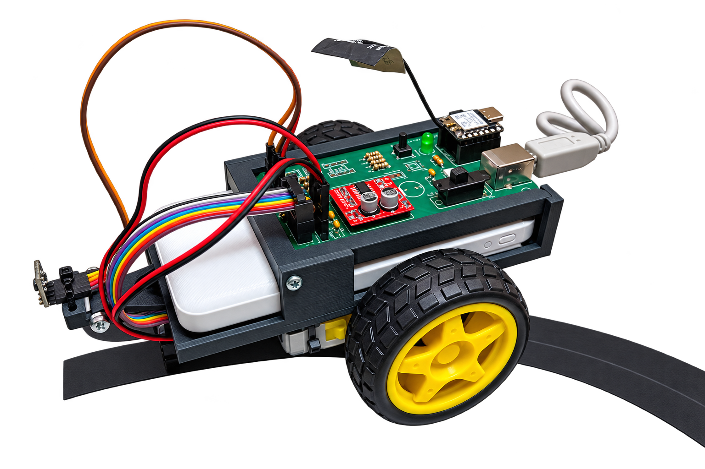
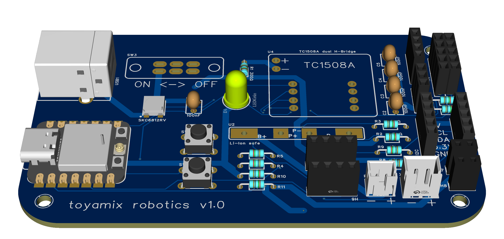
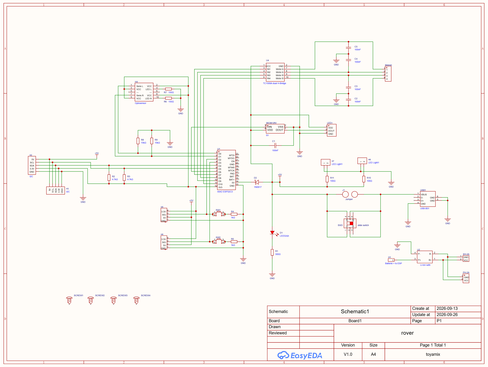

# TOYAMIX ROVER

**Build · Code · Explore**

TOYAMIX ROVER is a small, programmable robot based on the **Seeed Studio XIAO ESP32-C3** and **MicroPython**. It is designed for learning robotics, experimenting with sensors, and writing your own embedded software.

The rover uses a custom PCB, 3D-printed parts, two independently controlled motors, and several sensors. You can drive it from your phone or let it move autonomously.

## Features

- **Manual control:** Drive forward, backward, left, and right from a browser on your phone.
- **Obstacle avoidance:** Use a Time-of-Flight (ToF) distance sensor to detect obstacles and turn away from them.
- **Line following:** Follow a dark line using two analog reflectance sensors and a proportional controller.
- **Motor calibration:** Adjust left/right motor balance in the web interface. The setting is saved on the rover.
- **RGB status LED:** Indicates the selected operating mode.
- **Live diagnostics:** View sensor values, commands, memory usage, loop timing, and CPU frequency in the web interface.
- **Expandable software:** Modify the existing MicroPython code or develop your own programs.

## Hardware

| Component | Purpose |
| --- | --- |
| Seeed Studio XIAO ESP32-C3 | Main microcontroller with Wi-Fi |
| 2 DC motors | Independent left and right wheel control |
| Time-of-Flight distance sensor (VL53L0X) | Obstacle detection |
| 2 analog line sensors | Line detection and following |
| RGB LED | Mode and status indication |
| Custom PCB | Electrical connections |
| 3D-printed parts | Chassis and component mounts |
| USB power bank | Power supply |

The electronics are connected through the custom PCB. See the hardware designs for additional details.

## Getting started

### 1. Assemble and power the rover

Assemble the hardware and check all connections before powering it on. Attach the ESP32-C3 antenna before using Wi-Fi. The assemble menu can be found in the `Menu/` folder.

Switch the rover on and wait for the RGB LED to turn **red**. This indicates manual mode.

### 2. Connect to the rover

1. Open the Wi-Fi settings on your phone or computer.
2. Find the rover network. Its name is based on the final three bytes of the configured MAC address, for example **`Rover 7c:e5:cc`**.
3. Connect to that network. Whether a password is requested depends on the access-point security configuration of the firmware.
4. Open **[http://192.168.4.1](http://192.168.4.1)** in your browser.

The control page is hosted by the rover itself. You do not need an internet connection to use it.

### 3. Select a driving mode

You can switch modes using the button on the PCB or the arrows in the web interface.

| LED color | Mode | Description |
| --- | --- | --- |
| Red | Manual | Drive using the browser controls |
| Blue | Obstacle avoidance | Drive autonomously and avoid obstacles |
| Yellow | Line following | Follow a dark line with the line sensors |
| Orange | Obstacle avoidance stopped | The rover could not find a clear path within the turning timeout |

In manual mode, hold a direction button to drive and release it to stop. If obstacle avoidance stops after a failed turn, switch modes to reset it.

### 4. Calibrate the motors

The motors may run at slightly different speeds. Use the **Motor Calibration** controls (`−` and `+`) in the browser to adjust the balance while testing straight-line driving.

The calibration value is stored on the ESP32-C3 and is restored after a restart. It affects straight driving, not turning in place or the line-following controller.

## Software

The rover runs **MicroPython** on the XIAO ESP32-C3. [Thonny](https://thonny.org/) can be used to upload files and edit programs.

The main firmware files are located in [`software/`](software/):

| File | Purpose |
| --- | --- |
| `main.py` | Initializes the hardware and runs the three driving modes |
| `webserver.py` | Starts the Wi-Fi access point, serves the control page, and handles commands |
| `rgbLED.py` | Controls the RGB LED |
| `vl53l0x.py` | Driver for the distance sensor |

Small hardware test programs are available in [`software/example/`](software/example/). They are useful for experimenting with individual components.

### Uploading the software

1. Install MicroPython for the **Seeed Studio XIAO ESP32-C3** if it is not already installed. Use the [official firmware download page](https://micropython.org/download/SEEED_XIAO_ESP32C3/).
2. Connect the board to your computer by USB-C.
3. Open Thonny and select the MicroPython interpreter and the correct serial port.
4. Upload the Python files from `software/` to the root directory of the ESP32-C3 filesystem. Keep `main.py` as the startup program.
5. Restart the board.

If you modify the code, save your changes to the rover and restart it to test them.

## Hardware design

The PCB schematic and layout files are available in [`hardware/`](hardware/). They were created with **EasyEDA Pro**.

The repository is intended as a starting point for exploring the hardware and adapting the rover to your own projects.

## Safety and limitations

- **Do not change wiring while the rover is powered on.** Check connections and polarity before startup.
- **Connect the antenna before enabling Wi-Fi.**
- **Test the motors with the wheels lifted off the ground** when making software changes.
- The web interface is intended for use near the rover. **The current manual-control loop does not have a command-timeout watchdog:** if a stop command is not received after a connection failure, the last motion can continue. Keep the rover supervised and switch off power if control is lost.
- Wi-Fi access and authentication depend on the firmware configuration. Do not assume that other nearby users are prevented from connecting.

## Further development

You can change motor speeds, sensor thresholds, obstacle-avoidance behavior, and the line-following controller in `software/main.py`. You can also use the example scripts as a starting point for your own programs.

Contributions, feedback, and experiments are welcome through this repository.

## License

All original code, 3D models, PCB designs, and documentation created by the TOYAMIX ROVER project are free to use.

Third-party components, such as the `vl53l0x` library, remain subject to their respective licenses and copyright notices. Their original authors retain their rights.
